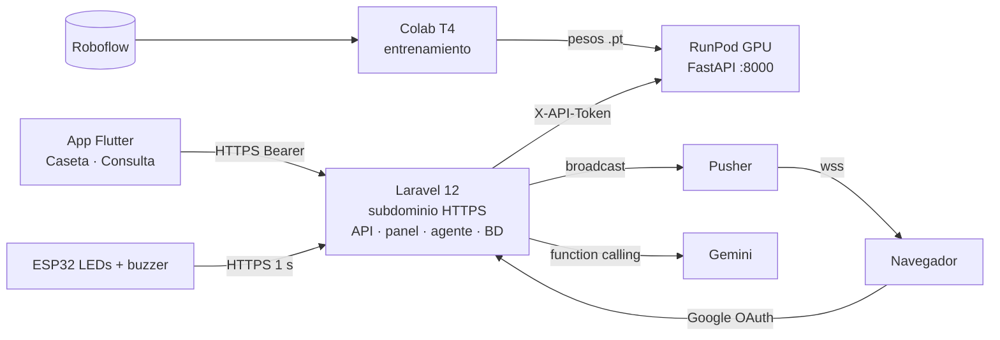

# 🚧 Sistema Inteligente de Control de Peaje

**IAM-811 Machine Learning y Aprendizaje Profundo · Laboratorio Final de Hito** — Entrega **individual** con los
**4 apartados adicionales (+20 pts)**: entornos reproducibles, inferencia en RunPod, conteo de pasajeros y hardware ESP32.

| Autor | Rol |
|---|---|
| **Jayu Tomas Mendoza Amaru** | Desarrollador integral · entrega individual (datasets, entrenamiento, inferencia, web, móvil, hardware y documentación) |

El sistema identifica cada vehículo que pasa por una caseta con **tres inferencias** y cobra la tarifa en bolivianos:

| | Tarea | Tipo de inferencia | Modelo |
|---|---|---|---|
| **M1** | Placa boliviana (`^\d{3,4}[A-Z]{3}$`) | Detección + OCR | YOLOv9-t ONNX + fast-plate-ocr |
| **M2** | Categoría: auto, minibús, bus, camión (+ moto) | Segmentación de instancias | YOLO11s-seg (Roboflow + Colab) |
| **M3** | Número de ejes | Keypoints de llantas (5 por llanta) | YOLO11s-pose (Roboflow + Colab) |
| **M4** *(bono)* | Pasajeros visibles dentro del vehículo | Segmentación (clase persona) | YOLO11s-seg — **sin reconocimiento facial** |

> **Cero recursos locales:** Roboflow (datasets) → Colab (entrenamiento) → **RunPod** (inferencia, puerto 8000) →
> subdominio **HTTPS** en **Render** (Laravel en Docker + PostgreSQL: web + API + BD + agente) → **Pusher**
> (tiempo real) → **ESP32** por HTTPS.

## Enlaces de la entrega

| Recurso | Enlace |
|---|---|
| Panel web (subdominio HTTPS, Render) | `https://peaje-ia.onrender.com` o `https://peaje.tu-dominio.com` ← *reemplazar* |
| Servidor de inferencia RunPod | `https://<POD_ID>-8000.proxy.runpod.net/health` ← *reemplazar* |
| Datasets de Roboflow (M2 vehículos · M3 llantas · M4 pasajeros) | `https://universe.roboflow.com/<workspace>/<proyecto-m2>` · `…/<proyecto-m3>` · `…/<proyecto-m4>` ← *reemplazar* |
| APK Android | carpeta de Google Drive `/apk` |
| Video demostrativo (8–12 min) | carpeta de Google Drive `/video` |
| Exportación de la BD | carpeta de Google Drive `/base_de_datos` (`php artisan peaje:exportar-bd`) |

El correo del docente **`doc.alvaro.pinto.ma@unifranz.edu.bo`** está precargado como **administrador activo**.

## Arquitectura



Detalle (secuencias, ER, decisiones): [`docs/arquitectura.md`](docs/arquitectura.md).

## Estructura del repositorio

```text
sistema-peaje-ia/
├── entrenamiento/                 # 4 notebooks autocontenidos para Colab T4
│   ├── 01_m1_placas_bolivia_ocr.ipynb        # SHA-256, fast-plate-ocr vs EasyOCR vs Tesseract, métricas OCR
│   ├── 02_m2_segmentacion_vehiculos_yoloseg.ipynb   # mAP50/50-95 box+mask, matriz de confusión
│   ├── 03_m3_keypoints_llantas_yolopose.ipynb       # auto-etiquetado, mAP50 pose, MAE de ejes
│   └── 04_m4_segmentacion_pasajeros.ipynb           # mAP + MAE de conteo, privacidad
├── inferencia/                    # FastAPI unificado (RunPod + Colab)
│   ├── app.py                     # GET /health · POST /inferir · POST /inferir-placa
│   ├── peaje_ia/                  # m1_placas · m2_vehiculos · m3_ejes · m4_pasajeros · anotador · pipeline
│   ├── requirements-venv.txt  environment-conda.yml  environment-mamba.yml
│   ├── diagnostico_entorno.py  setup_runpod.sh  Dockerfile
│   ├── servidor_inferencia_runpod_colab.ipynb
│   └── tests/                     # pytest (contrato JSON, token, normalización)
├── web/                           # Laravel 12: panel Blade + API REST + agente + BD
│   ├── Dockerfile  docker-entrypoint.sh      # imagen PHP 8.3 + Apache para Render / Docker
├── movil/                         # Flutter (Android APK): Google Sign-In, Modo Caseta, Modo Consulta
├── hardware/esp32_alerta_peaje/   # firmware .ino + secrets.h.example + DIAGRAMA_CONEXION.md
├── docs/                          # openapi.yaml · postman_collection.json · arquitectura.md · plantilla_informe_tecnico.md
├── render.yaml                    # Blueprint de Render: servicio web Docker + PostgreSQL (plan gratuito)
└── GUIA_PASO_A_PASO_POST_DESARROLLO.md   # ← manual de despliegue y guion del video
```

## Funcionalidades

**Web (Laravel 12, Blade + Bootstrap 5):** login **exclusivo con Google** (Socialite) + lista blanca + pantalla
*Acceso denegado* · roles `administrador` / `operador` · **panel en tiempo real** (pasos, recaudación Bs, alertas,
pasajeros y lista en vivo con evidencia) · CRUD de vehículos, tarifas, casetas y usuarios · historial de pasos con
filtros y modal de evidencia · alertas en vivo con sonido y *Marcar como atendida* · **chat del agente** en `/chat`
y **burbuja flotante** en todo el panel (texto + imagen) · **Estado del sistema** con ping a `INFERENCE_URL/health`
(GPU, modelos, latencia), estado del ESP32 y formulario para cambiar `INFERENCE_URL` **sin redeploy**.

**API REST v1** (Bearer Sanctum emitido tras validar el Google ID Token):

| Método | Ruta | Descripción |
|---|---|---|
| POST | `/api/v1/auth/google` | ID Token → token + rol · **403** si no está en la lista blanca |
| POST | `/api/v1/pasos/frame` | frame → inferencia → tarifa → saldo → evidencia → alerta → tiempo real → ESP32 |
| POST | `/api/v1/placas/consultar` | 4 estados + sugerencias |
| POST | `/api/v1/placas/consultar-imagen` | lee la placa (M1) y consulta |
| GET | `/api/v1/placas/{placa}/historial` | últimos pasos |
| GET | `/api/v1/casetas/{id}/resumen` | resumen del día |
| POST | `/api/v1/agente/chat` | `mensaje` y/o `imagen` |
| GET | `/api/v1/hardware/ultimo-evento` | `X-Hardware-Token` · `{id, tipo_senal, placa, monto, timestamp}` |

Especificación completa: [`docs/openapi.yaml`](docs/openapi.yaml) · colección: [`docs/postman_collection.json`](docs/postman_collection.json).

**Agente conversacional:** `AgentePeajeService` con *function calling* (Gemini por defecto; OpenAI, Groq u Ollama
por `.env`) sobre herramientas que consultan **solo la BD**, y respaldo determinista si el LLM falla. Normaliza la
placa, corrige errores OCR (`O↔0, I↔1, B↔8, S↔5, 3↔8`, Levenshtein ≤ 2) y responde *"¿Quisiste decir …?"*.
Estados: **1** registrada y con paso · **2** registrada sin paso · **3** identificada no registrada (posible evasión) · **4** no existe.

**Datos iniciales:** las **22 fotos de placas bolivianas** del curso están en `web/database/seeders/evidencias/`
(con `manifest.csv`) y se cargan como registros base y primeras evidencias: 22 vehículos (con saldo y pasos,
sin paso, sin saldo), 3 placas detectadas **no registradas** (evasión), 2 fotos **ilegibles**, 3 casetas paceñas y
tarifas en Bs por categoría y ejes (2–6+).

| Tarifas (Bs) | 2 ejes | 3 | 4 | 5 | 6+ |
|---|---|---|---|---|---|
| Moto | 3 | — | — | — | — |
| Auto | 6 | 9 | 12 | 15 | 18 |
| Minibús | 8 | 12 | 16 | 20 | 24 |
| Bus | 15 | 21 | 27 | 33 | 39 |
| Camión | 15 | 25 | 35 | 45 | 55 |

## Puesta en marcha rápida

> La guía completa, en orden cronológico (Roboflow → Colab → RunPod → Google Cloud → Pusher/Gemini → subdominio →
> APK → ESP32 → pruebas → guion del video) está en **[`GUIA_PASO_A_PASO_POST_DESARROLLO.md`](GUIA_PASO_A_PASO_POST_DESARROLLO.md)**.

### Inferencia (RunPod)
```bash
git clone https://github.com/<usuario>/sistema-peaje-ia.git && cd sistema-peaje-ia/inferencia
export API_TOKEN="<token-largo>"
bash setup_runpod.sh venv          # crea el entorno, guarda la evidencia y levanta uvicorn en 0.0.0.0:8000
```

### Web en Render (gratuito, recomendado)
`render.yaml` crea el servicio web (Docker, raíz `web/`) y la BD PostgreSQL. Render → **New → Blueprint** → este
repositorio → completar `APP_KEY` (`php artisan key:generate --show`), `APP_URL`, `ADMIN_EMAIL`, `GOOGLE_*`,
`INFERENCE_*`, `HARDWARE_TOKEN`, `PUSHER_*` y `GEMINI_API_KEY`. Al arrancar, `docker-entrypoint.sh` ejecuta
`storage:link`, `migrate --force`, los seeders **solo si `usuarios` está vacía** y levanta Apache en `$PORT`.
Detrás del proxy HTTPS de Render se confía en `X-Forwarded-Proto` (`trustProxies('*')`) y en producción todas las
URLs (callback de Google, evidencias) se generan con `https`. Pasos y límites del plan gratuito: guía, Paso 6 · Opción C.

### Web (VPS / cPanel)
```bash
cd web && composer install --no-dev --optimize-autoloader
cp .env.example .env && php artisan key:generate      # completar GOOGLE_*, PUSHER_*, GEMINI_API_KEY, INFERENCE_*, HARDWARE_TOKEN
php artisan migrate --seed --force && php artisan storage:link
php artisan peaje:exportar-bd                         # respaldo SQL + JSON para Drive
```

### Móvil
```bash
cd movil && flutter build apk --release \
  --dart-define=API_BASE_URL=https://peaje.tu-dominio.com \
  --dart-define=GOOGLE_SERVER_CLIENT_ID=<WEB_CLIENT_ID>.apps.googleusercontent.com
```

## Recreación de entornos (bono +5: conda · mamba · venv)

Versiones **fijadas** y verificadas con `pip freeze` (Python 3.11.18): torch 2.15.0, ultralytics 8.4.218,
onnxruntime 1.32.0, fast-plate-ocr 1.1.0, FastAPI 0.165.0, OpenCV 5.1.0.95.

| Entorno | Archivo | Lector OCR adicional | Crear | Verificar |
|---|---|---|---|---|
| **venv** | `inferencia/requirements-venv.txt` | fast-plate-ocr (principal) | `python3.11 -m venv peaje-venv && source peaje-venv/bin/activate && pip install -r requirements-venv.txt` | `python diagnostico_entorno.py --nombre venv` |
| **conda** | `inferencia/environment-conda.yml` | Tesseract 5.5 (binario nativo) | `conda env create -f environment-conda.yml && conda activate peaje-conda` | `python diagnostico_entorno.py --nombre conda` |
| **mamba** | `inferencia/environment-mamba.yml` | EasyOCR 1.7.2 (PyTorch) | `mamba env create -f environment-mamba.yml && mamba activate peaje-mamba` | `python diagnostico_entorno.py --nombre mamba` |

Windows (PowerShell): `py -3.11 -m venv peaje-venv; .\peaje-venv\Scripts\Activate.ps1; pip install -r requirements-venv.txt`
(en Windows/macOS la rueda de torch de PyPI es CPU; en Linux/RunPod incluye CUDA).

`diagnostico_entorno.py` imprime y guarda `evidencia_entorno_<nombre>.txt/.json` con SO, Python, ejecutable, gestor
de entorno, PyTorch, CUDA, GPU, Ultralytics, ONNX Runtime (+providers), OpenCV, fast-plate-ocr, EasyOCR, Tesseract
y FastAPI. Estas evidencias van a la carpeta de Drive. Cada servicio fija sus propias versiones:

| Servicio | Gestor de dependencias |
|---|---|
| Inferencia | `requirements-venv.txt`, `environment-conda.yml`, `environment-mamba.yml`, `Dockerfile` |
| Entrenamiento (Colab) | `pip install ultralytics==8.4.218 …` en la 1.ª celda de cada notebook |
| Web | `composer.lock` (PHP 8.3, Laravel 12) · `web/Dockerfile` (php:8.3-apache-bookworm) |
| Móvil | `pubspec.lock` (Flutter 3.44) |
| Hardware | Arduino core esp32 + ArduinoJson 7.x |

## Pruebas

| Componente | Comando | Resultado al entregar |
|---|---|---|
| Web | `cd web && php artisan test` | 42 pruebas ✔ en **SQLite y PostgreSQL 17** (auth Google/403, 4 estados, pasos, ESP32, roles, exportación, arranque Render, HTTPS tras proxy) |
| Inferencia | `cd inferencia && API_TOKEN=test pytest -q tests/` | 12 pruebas ✔ (contrato JSON, token, normalización) |
| Móvil | `cd movil && flutter analyze && flutter test` | sin issues · 2 pruebas ✔ |

## Seguridad

* `.gitignore` estricto: **nunca** se versionan `.env`, API keys, `client_secret`, `google-services.json`, keystores
  `.jks`/`key.properties` ni `secrets.h`. Solo plantillas: `.env.example`, `secrets.h.example`.
* `INFERENCE_TOKEN` se guarda **cifrado** (APP_KEY) en `configuraciones`; la exportación de BD omite secretos.
* ESP32 con `X-Hardware-Token`; servidor de inferencia con `X-API-Token` (comparación en tiempo constante).
* **Privacidad M4:** solo se cuentan personas; sin reconocimiento facial ni recortes; la evidencia guardada es la
  imagen anotada con máscara opaca (nunca el frame crudo). La app borra cada foto tras enviarla.

## Créditos

Detector y lector de placas: `open-image-models` y `fast-plate-ocr` (ankandrew). Lógica de ejes basada en el
notebook del docente *keypoints_llantas_yolo_detectron2_v3*. Ultralytics YOLO11 / YOLOE.
