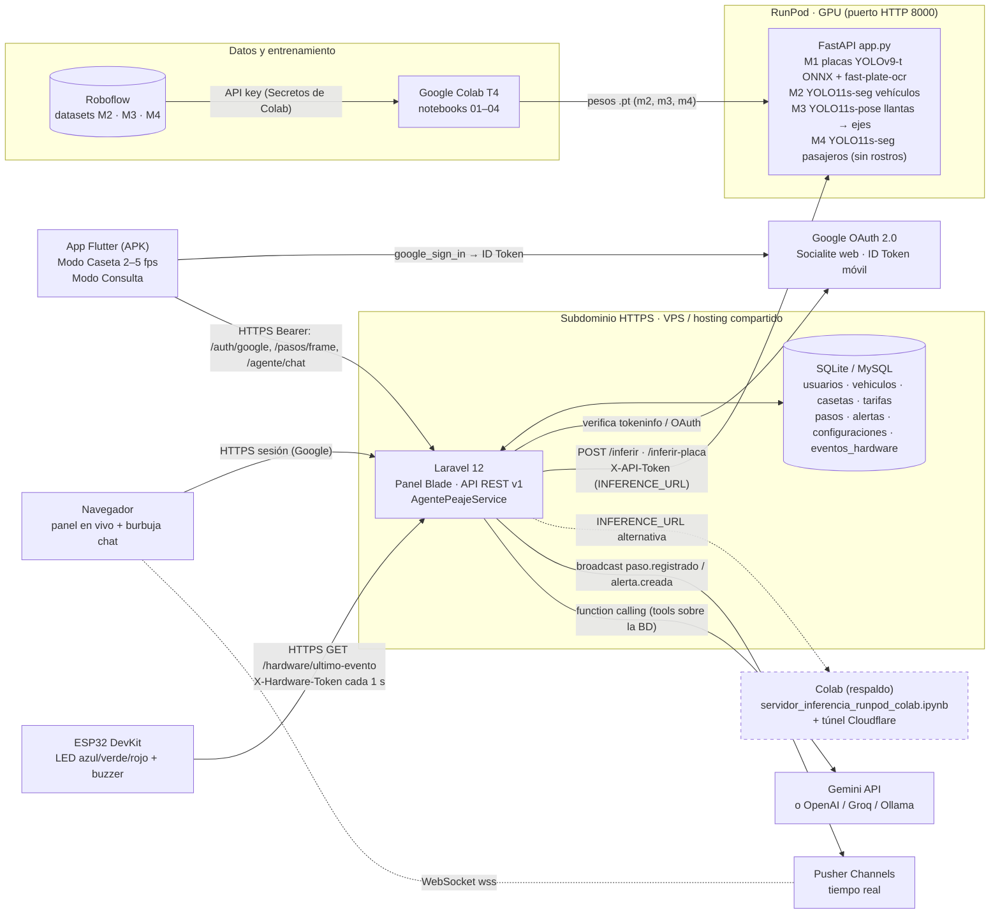
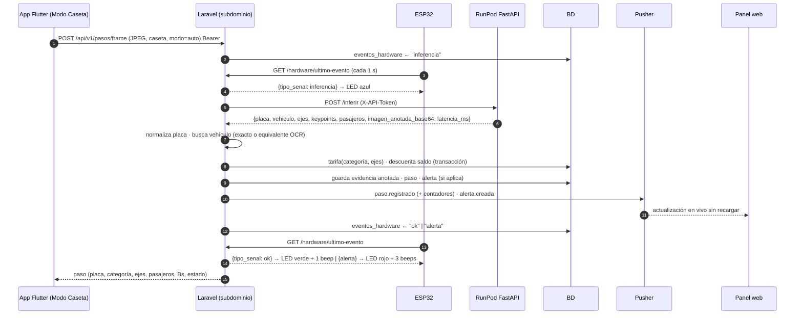
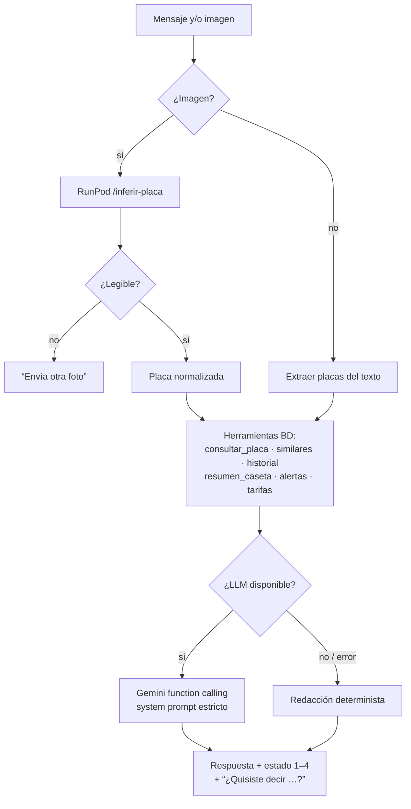
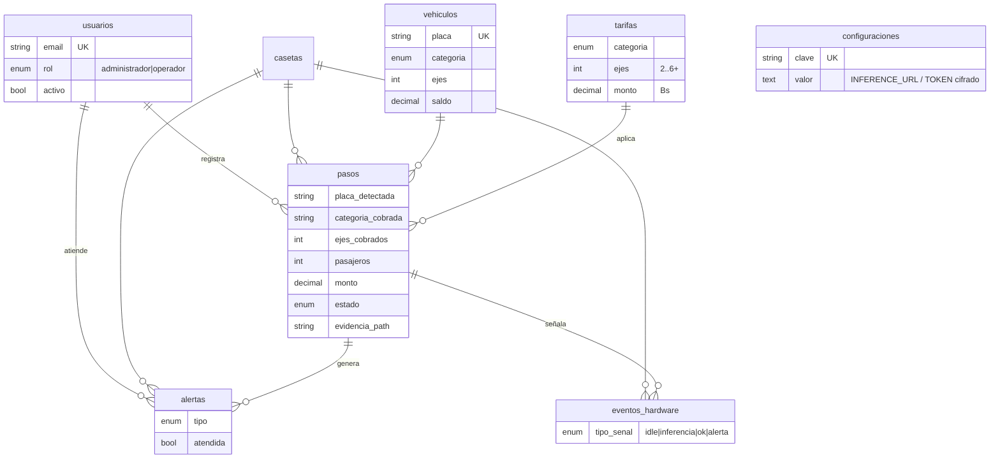

# Arquitectura — Sistema Inteligente de Control de Peaje

Todo corre en la nube: **nada depende de `localhost`, IPs privadas ni túneles a una PC personal.**

## Diagrama general

## Secuencia de un paso por la caseta

## Agente conversacional

| Estado | Condición | Respuesta |
|---|---|---|
| 1 Registrada y con paso | en `vehiculos` y con pasos | fecha/hora, caseta, categoría, ejes, monto |
| 2 Registrada sin paso | en `vehiculos`, sin pasos | datos del vehículo y saldo |
| 3 Identificada no registrada | no en `vehiculos`, sí en `pasos` | **alerta de posible evasión** |
| 4 No existe | en ninguna tabla | + sugerencias Levenshtein ≤ 2 (O↔0, I↔1, B↔8, S↔5, 3↔8) |

## Modelo de datos

## Decisiones de diseño

| Tema | Decisión | Motivo |
|---|---|---|
| Tiempo real | Pusher por defecto, Reverb por `.env`, **respaldo por sondeo** cada 5 s | Hosting compartido no permite WebSockets propios; el panel nunca queda congelado |
| ESP32 | Polling HTTPS 1 s, eventos con vigencia de 12 s | Funciona en cualquier hosting, sin puertos ni broker MQTT |
| Video móvil | `takePicture` a 2–5 fps con **una sola petición en vuelo** | No satura red ni GPU; ticks sobrantes se descartan |
| Anti-duplicados | misma placa + caseta en 60 s no se cobra de nuevo | Frames consecutivos del mismo vehículo |
| Ejes | M3 en vista lateral; frontal/posterior → ejes registrados o mínimo 2 | Regla del docente (no hay vehículos de 1 eje) |
| OCR | Corrección por posición del formato boliviano + equivalencia OCR única al cobrar | Bolivia no está en el set de entrenamiento de fast-plate-ocr |
| Privacidad M4 | Solo conteo; máscara **opaca**; se guarda solo la imagen anotada | Prohibido reconocimiento facial y recortes de rostros |
| Secretos | `.env` / `secrets.h` ignorados; `INFERENCE_TOKEN` cifrado con `APP_KEY` en BD | Penalización −10 pts |
