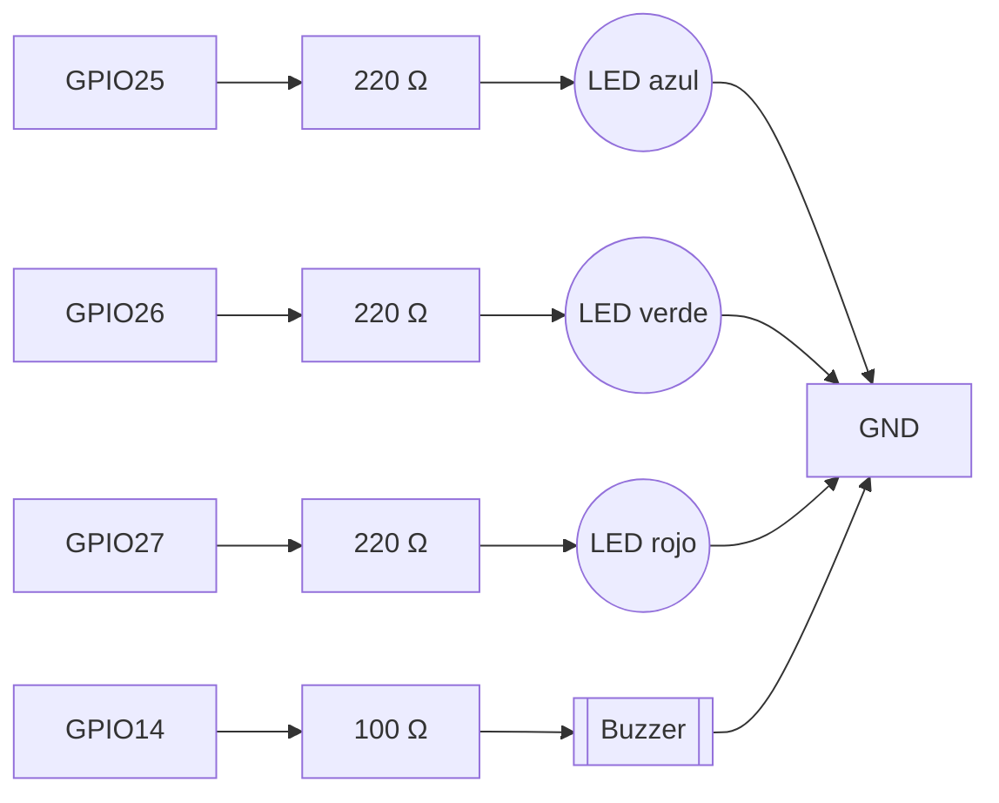

# Diagrama de conexión · ESP32 DevKit V1 (38 pines) — alertas del peaje

## Materiales

| Cant. | Componente | Nota |
|---|---|---|
| 1 | ESP32 DevKit V1 (38 pines, ESP-WROOM-32) | cable USB de **datos** |
| 1 | LED azul 5 mm | inferencia en curso |
| 1 | LED verde 5 mm | paso autorizado |
| 1 | LED rojo 5 mm | alerta (evasión / sin saldo / ilegible) |
| 3 | Resistencias 220 Ω | una por LED (limitan la corriente a ~6–8 mA a 3.3 V) |
| 1 | Buzzer pasivo 3.3–5 V (o activo) | `BUZZER_PASIVO` en `secrets.h` |
| 1 | Resistencia 100 Ω (opcional) | en serie con el buzzer |
| 1 | Protoboard + cables dupont macho-macho | |

## Tabla de pines

| Señal | GPIO | Pin físico (lado) | Conexión |
|---|---|---|---|
| LED **Azul** (inferencia) | **GPIO 25** | D25 (izquierdo) | GPIO25 → 220 Ω → ánodo (+, pata larga) → cátodo → GND |
| LED **Verde** (ok) | **GPIO 26** | D26 (izquierdo) | GPIO26 → 220 Ω → ánodo → cátodo → GND |
| LED **Rojo** (alerta) | **GPIO 27** | D27 (izquierdo) | GPIO27 → 220 Ω → ánodo → cátodo → GND |
| **Buzzer** | **GPIO 14** | D14 (izquierdo) | GPIO14 → (100 Ω) → buzzer (+) · buzzer (−) → GND |
| Tierra común | GND | GND (cualquiera) | riel negativo de la protoboard |

> Los GPIO 25/26/27/14 son salidas seguras (no son pines de arranque *strapping*: 0, 2, 5, 12, 15).

## Esquema

```text
                 ESP32 DevKit V1 (38 pines)
               ┌───────────────────────────┐
               │ 3V3                   VIN │
               │ GND ●──────────┐      GND │
               │ ...            │      ... │
               │ D25 ●──[220Ω]──┼──▶|──┐   │   LED AZUL
               │ D26 ●──[220Ω]──┼──▶|──┤   │   LED VERDE
               │ D27 ●──[220Ω]──┼──▶|──┤   │   LED ROJO
               │ D14 ●──[100Ω]──┼──(BZ)┤   │   BUZZER
               │                │      │   │
               └────────────────┼──────┼───┘
                                └──────┴──── GND (riel −)
   ▶| = LED (ánodo → cátodo)    (BZ) = buzzer (+ → −)
```



## Comportamiento

| `tipo_senal` del backend | LED | Buzzer |
|---|---|---|
| `inferencia` (frame enviado a RunPod) | Azul parpadea 2 Hz | — |
| `ok` (paso autorizado, saldo descontado) | Verde fijo 3 s | 1 beep corto |
| `alerta` (no registrada / sin saldo / ilegible / error) | Rojo parpadeo rápido 4 s | 3 beeps |
| `idle` | apagado (pulso azul cada 5 s = vivo) | — |
| sin Wi-Fi | Rojo parpadeo lento | — |

## Flujo de red (100 % nube)

```text
ESP32 ──HTTPS GET cada 1 s──▶ https://peaje.tu-dominio.com/api/v1/hardware/ultimo-evento
        X-Hardware-Token                    (Laravel en VPS / hosting compartido)
```
No hay servidor en la PC: el ESP32 solo necesita Wi-Fi con salida a internet (puede ser el hotspot del celular).

## Carga del firmware (Arduino IDE 2.x)

1. *Preferencias → URLs adicionales*: `https://espressif.github.io/arduino-esp32/package_esp32_index.json`
2. *Gestor de placas* → instalar **esp32 by Espressif Systems**. Placa: **ESP32 Dev Module**.
3. *Gestor de librerías* → instalar **ArduinoJson** (Benoit Blanchon) 7.x.
4. Copiar `secrets.h.example` → `secrets.h` y completar Wi-Fi, `API_HOST`, `HARDWARE_TOKEN`, `CASETA_ID`.
5. Conectar el ESP32, elegir el puerto COM y **Subir** (si no conecta, mantener presionado *BOOT* al iniciar la carga).
6. Monitor serie a **115200 baudios**: debe mostrar `[wifi] OK` y `[sync] último evento id=…`.
